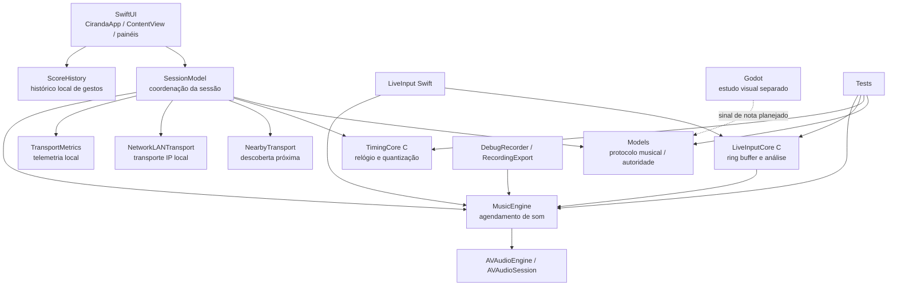
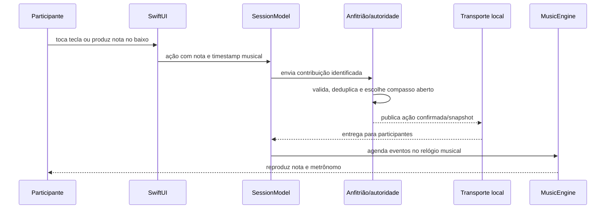
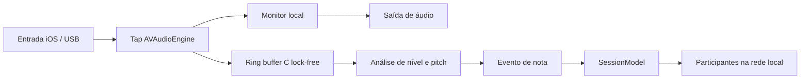
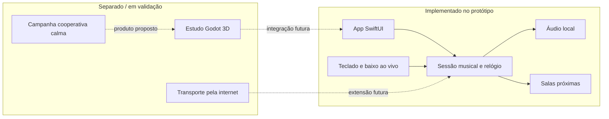

# Arquitetura do protótipo Rodopio

Este documento descreve o protótipo iOS presente neste repositório. A interface SwiftUI, o motor de áudio e a sessão colaborativa estão implementados em graus diferentes; o projeto Godot é um estudo visual independente. Não há integração Godot–iOS compilada nem serviço de sessão pela internet.

## Mapa de módulos

## Fluxo de uma contribuição

O percurso de baixo ao vivo tem duas saídas: monitoração de áudio de baixa latência e análise assíncrona para reconhecer notas. O callback de captura escreve em ring buffer C; a análise não ocorre no callback. Somente eventos musicais, e não o PCM, são enviados pelo protocolo de sessão padrão.

## Limites e evolução

Veja também a [proposta de MVP](plan/game-mvp/README.md) e a [documentação do Godot](GODOT.md).

---

# Tempo compartilhado

`SessionAuthority` no anfitrião define época, BPM e compassos. Cada cliente estima offset por quatro timestamps monotônicos e usa a amostra de menor RTT numa janela de 20. A estimativa presume atrasos aproximadamente simétricos; não há garantia sob assimetria. O relógio é amostrado a cada 150 ms durante entrada e a cada 2 s depois. Durante playback a correção é limitada a 0,5 ms por amostra; deriva maior demanda medição e futura política de ressincronização.

Ações chegam com UUID e timestamp musical. A chegada seleciona o primeiro compasso aberto; o gesto seleciona uma das oito posições de colcheia. O host confirma o destino, deduplica UUID e fecha o compasso 500 ms antes do início. Hash SHA256 usa conteúdo canônico para comparar os dois logs; ele não é um mecanismo de autenticação.

O limite de 64 eventos por compasso contém crescimento acidental. Ações expiram localmente após 25 s sem confirmação. O servidor rejeita timestamps fora de uma janela de 30 s. A avaliação pedagógica de ritmo e a prevenção de fraude não estão implementadas.

A programação de áudio é serializada em uma fila dedicada. Timbres são pré-calculados; não há alocação nem chamada de rede num render callback implementado pelo app. AVAudioPlayerNode recebe horários de host. O metrônomo é independente das contribuições e tem fila de 200 ms; áudio já agendado não é reescrito por alterações posteriores no offset.

Snapshot confiável a cada segundo oferece os últimos oito compassos confirmados, permitindo recuperar broadcasts perdidos quando ainda há antecedência. Um cliente que entra no meio da sessão não toca compassos antigos. `stop` é identificado pela sessão. O cliente só aceita comandos de seu anfitrião conectado.

A simulação 3D futura consumirá o mesmo protocolo. MultipeerConnectivity deverá ganhar uma alternativa para internet e outras plataformas; manter transporte separado evita acoplar as regras à descoberta Apple.

## Entrada ao vivo 0.2

Um único AVAudioEngine e uma única AVAudioSession coordenam reprodução e entrada. Habilitar captura solicita permissão explícita, configura `.playAndRecord` / `.measurement`, ativa a sessão, enumera entradas e prefere USB. Ao selecionar porta, verifica a rota efetivamente aceita; não afirma que a preferência sempre foi atendida.

Grafo: inputNode → monitorMixer → mainMixer → output. O monitorMixer começa em volume zero. O tap de entrada escreve o canal escolhido em ring buffer C com índices atômicos lock-free. Não há FFT, alocação, despacho de UI, rede, gravação ou espera no tap. A fila de análise drena o ring a cada 60 ms, calcula nível/pico e estima pitch por diferença cumulativa normalizada (abordagem YIN), após redução de taxa por média em blocos.

A janela de 2048 amostras reduzidas suporta os graves do baixo. O objetivo é reconhecer notas isoladas, não fazer afinação profissional nem seguir polifonia. O atraso de análise é independente da monitoração. Overflow descarta dados e limpa o histórico do detector. IDs de captura impedem que leituras antigas atualizem uma entrada nova depois da troca.

Somente eventos de nota entram no protocolo musical. Ainda não existe codec de áudio, gravação em loop, envio de PCM ou estimativa precisa do ataque. Não usar o timestamp da identificação como julgamento pedagógico do gesto.

Fontes oficiais consultadas:
- https://developer.apple.com/documentation/avfaudio/avaudiosession/setpreferredinput(_:)
- https://developer.apple.com/documentation/avfaudio/avaudioengine/inputnode
- https://developer.apple.com/documentation/avfaudio/avaudioapplication/requestrecordpermission(completionhandler:)

## Transição de rota 0.2.1

A seleção deixou de fazer uma comparação síncrona imediatamente após `setPreferredInput`. Um pedido identificado por UUID permanece pendente até a rota solicitada e um formato Float32 válido permanecerem estáveis por 100 ms. O prazo total é 3 segundos; a checagem é reativada por notificações de rota e por poll de 100 ms na fila de áudio, sem dormir/bloquear essa fila.

`Core/RouteTransition.c` implementa a política de espera, formato ainda pendente, indisponibilidade e timeout. `MusicEngine` faz as chamadas Apple, cancela polls obsoletos e só conecta o tap depois da confirmação. Falhas mantêm as entradas visíveis para nova tentativa, com captura desligada. `requestedUID` não substitui `selectedUID`, que representa a rota efetiva observada.

A UI usa uma sheet com botões em vez de um Picker cujo binding depende de uma operação assíncrona. Notificações geradas pela própria troca não encerram a sala. Desconexões reais ou mudanças de formato invalidam a captura. O diagnóstico registra pedidos e confirmações separadamente.

Fonte: https://developer.apple.com/documentation/avfaudio/avaudiosession/setpreferredinput(_:)
