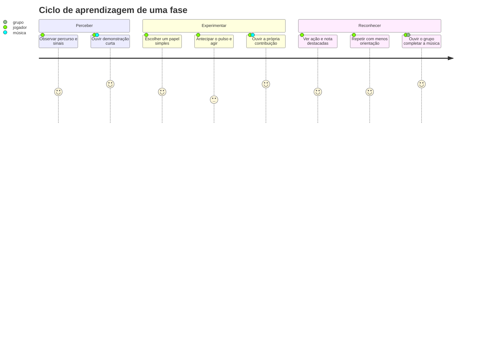
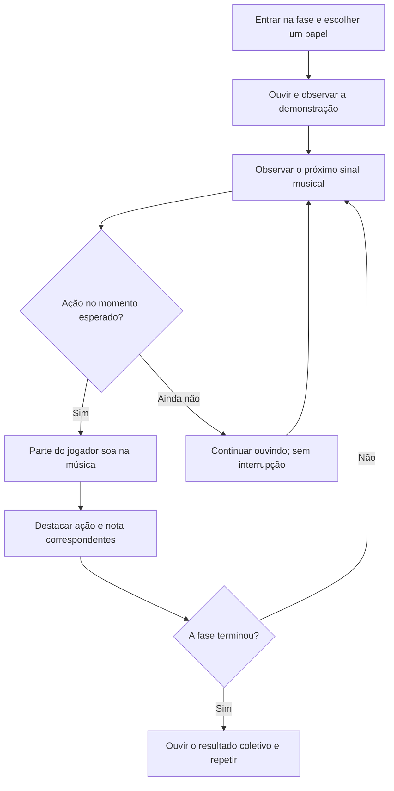

# Rodopio — proposta de MVP do jogo

## Resumo

Rodopio é uma experiência cooperativa para aprender noções musicais por meio de ações simples em um mundo visual. O jogador não começa compondo livremente: percorre uma música já estruturada, aprende seu pulso e percebe como suas ações correspondem a notas, pausas e compassos. A contribuição de cada pessoa é audível, e o grupo completa a mesma música.

O primeiro recorte deve ser tranquilo, atraente e legível. O mundo oferece espaço para escutar e antecipar; a interação traz a noção rítmica sem excesso de estímulos, competição ou punição por errar.

## Princípios de experiência

- **Aprender pela ação:** movimento, espera e toque ensinam pulso e compasso antes da leitura formal.
- **Uma descoberta de cada vez:** apresentar primeiro pulso; depois pausas, alturas, duração e leitura da pauta.
- **Poucos sinais visuais:** cada elemento tem um significado musical estável e claro.
- **Retorno gentil:** som, luz e movimento indicam o momento; uma tentativa fora do tempo não interrompe a música.
- **Cooperação acessível:** cada participante tem uma parte simples e percebe sua contribuição na música comum.
- **Sem pressão por pontuação:** repetição e escuta são meios de aprender; domínio e competição não são requisitos.

## Mapeamento música–mundo

| Conceito | Representação proposta |
| --- | --- |
| Pulso / tempo | Cadência previsível do percurso e dos pontos de ação. |
| Compasso | Trecho curto do caminho com começo e fim perceptíveis. |
| Altura | Altura vertical ou nível do item: posição mais alta representa nota mais aguda. |
| Duração | Ação sustentada ou elemento visual alongado. |
| Pausa | Espaço deliberado sem item ou ação, no qual se escuta. |
| Parte musical | Papel/instrumento assumido por cada jogador. |
| Partitura | Guia visual que pode revelar-se gradualmente e destacar junto do item a nota executada. |

As associações devem ser consistentes entre fases. O item no mundo e a nota correspondente na pauta podem iluminar-se juntos para conectar experiência e notação.

## Fase inicial proposta

- Uma música curta e predefinida em ritmo reggae.
- Oito compassos em 4/4, Dó maior, andamento inicial de 76 BPM.
- Três papéis cooperativos: tríade/movimento melódico simples no baixo; marcação simples na bateria; acorde estático na guitarra.
- Demonstração audível antes da primeira tentativa; depois orientação visual e repetição com menos ajuda.
- Um jogador pode explorar um papel enquanto os demais são simulados ou controlados por outros participantes.
- Espaço curto para observar antes de agir; ausência de cronômetro punitivo e placar competitivo.

Os valores acima vieram do primeiro mock-up e servem como hipótese de protótipo, não como especificação musical final.

## Ciclo de jogo

## Critério de aprendizagem a investigar

Depois de jogar, a pessoa consegue relacionar o momento da ação com o pulso/compasso e, quando houver variação de altura, relacionar a posição do elemento com uma nota mais grave ou aguda? O primeiro protótipo deve observar compreensão, conforto e desejo de repetir, além de verificar se cada participante consegue ouvir a própria contribuição.

Não há avaliação pedagógica implementada ainda. O app atual oferece sincronização de sessões, instrumentos de entrada e pauta/histórico limitado; o Godot é um estudo 3D separado, não uma fase jogável integrada.

## Fora do primeiro recorte

- Mundo aberto, exploração extensa e criação livre de música.
- Catálogo grande de instrumentos, lições e progressão de campanha.
- Pontuação, pressão de tempo e punição por erro.
- Leitura tradicional completa de partitura como pré-requisito.
- Integração do Godot com o app iOS e infraestrutura online, até que o loop de aprendizagem seja validado.

## Referências no projeto

- [Arquitetura atual](../../ARCHITECTURE.md)
- [Estudo Godot](../../GODOT.md)
- [Concorrentes e oportunidade](concorrentes.md)
- Sessão de descoberta: [Identificar concorrentes do Rodopio](codex://threads/01a19b12-e72b-74a3-9c9d-1dcd06e77dfc)
